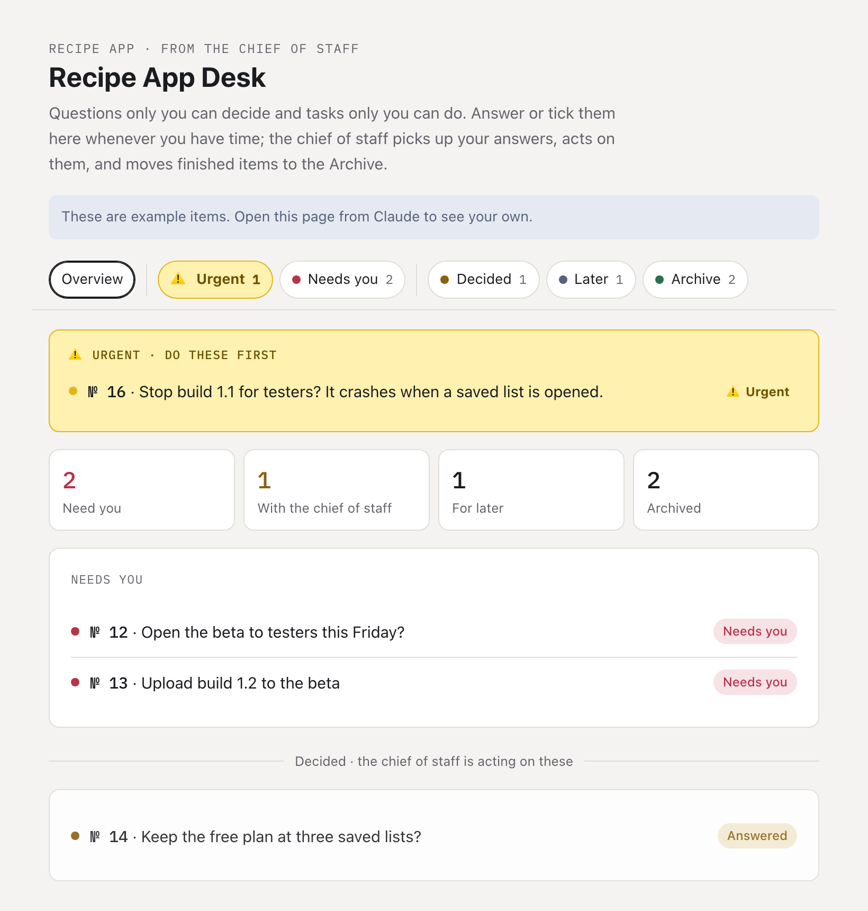
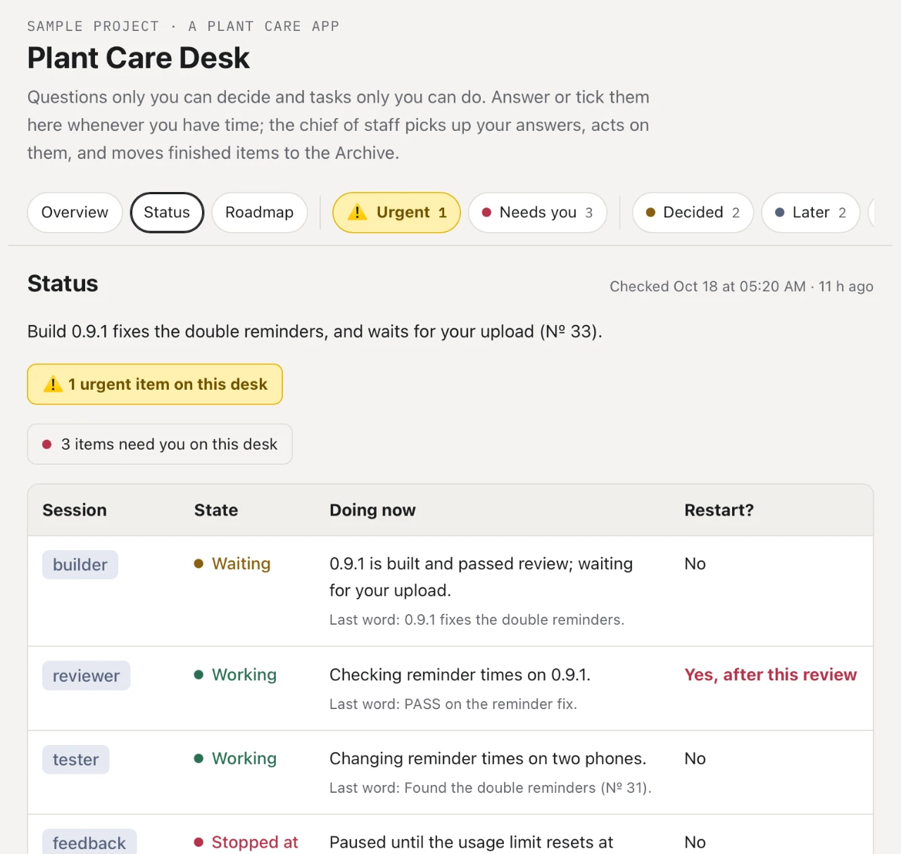
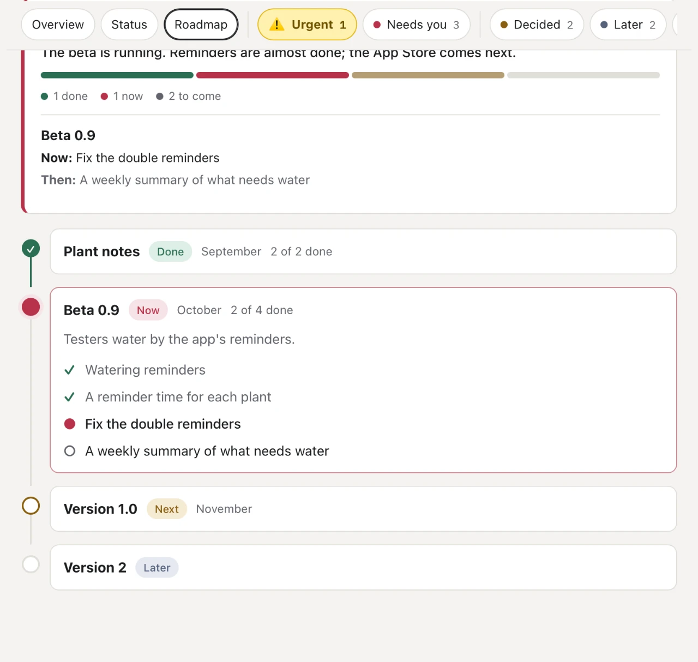

# agent-team-skills

Six Claude Code skills for running a team of Claude sessions without
reading every chat.

**[See how they change your workflow →](https://kl-autonomous.github.io/agent-team-skills/)**

> **What they need:** Claude Code. The skills where sessions talk to each
> other (build-review-loop, chief-of-staff) need the Claude desktop app's
> Code tab. owner-desk also needs Claude artifacts with a database
> (claude.ai or the desktop app).

| Skill | What it does | Useful from |
|---|---|---|
| [restart-ready](skills/restart-ready/) | Keeps a session's state in a few short .md files, so it can be thrown away and restarted fresh whenever its context grows, and lose nothing. It says when it's a good moment to restart, and writes the prompt for its own replacement. | one session |
| [build-review-loop](skills/build-review-loop/) | A builder builds one step at a time; an independent reviewer checks the exact commit in its own copy, re-runs everything, and answers PASS, FIX or STOP. An optional tester tries to break the risky parts. | two sessions |
| [chief-of-staff](skills/chief-of-staff/) | One session between you and the rest. It passes your words on exactly as you wrote them, gathers every session's questions into one numbered round, keeps hand-offs moving, keeps a status page, and tells you when a session should restart. | three or more sessions |
| [owner-desk](skills/owner-desk/) | A live board for everything only you can decide or do. You answer from your phone whenever you like, your answer wakes the agent, and it acts and archives the item. | any time decisions pile up |
| [side-session](skills/side-session/) | Fences off a helper session for one topic beside the team: it reads the project freely, keeps its own notes, never writes to the team's files or messages the team's sessions, and hands you a proposal with one line to paste. | one extra session for one thing |
| [compress-prompt](skills/compress-prompt/) | Shortens a prompt a model reads on every turn (a CLAUDE.md, a restart prompt, a skill) without changing what the model does: inventory first, uneven cuts, a check against the inventory, a test where one is possible, and a diff for you to read. Never for records of decisions. | any prompt paid on every turn |

They stack: every session is restart-ready; a builder and a reviewer form
the loop; a chief of staff runs the team for you; the desk holds what
waits for you; and a side session helps you with one thing without
touching any of that.

## Why I built this

I wanted to build an iPhone app without it being limited by what I know.
I'm not a Swift developer, and I didn't want to learn how to structure a
Swift project before I could start. So I let Claude write all of the code,
and I kept every decision for myself.

That worked, but problems came quickly. The biggest one was context. The
longer a session ran, the faster it burned through my usage, and most of
what it carried wasn't needed: a session building one feature doesn't need
the whole history of the project. But if I started a fresh session, I had
to explain everything again.

So I split the work up:

- **restart-ready** keeps the project's memory in a few short files instead
  of in the chat. A session can be restarted whenever its context gets big,
  and the new one picks up from the files. Nothing has to be explained
  twice.
- **build-review-loop** lets the builder focus on one feature at a time,
  and adds a reviewer that checks the work on its own. It runs the tests
  itself and makes sure they actually catch bugs. An AI that checks its own
  work tends to believe its own claims; a second one keeps it honest.
- **chief-of-staff** is the one session I talk to. It only passes messages
  and keeps track of the team, so it rarely needs a restart and doesn't
  need the most expensive model.
- **owner-desk** is where the chief of staff puts everything that needs my
  answer, so I can reply from my phone when I have time.

Having a chief of staff also made the whole setup modular. When I need
something new done, I add a session for that one job and connect it to the
chief of staff. I don't have to explain the project to it, and it can often
run on a cheaper model. Once the app was in beta, I added two:

- **A feedback session** reads the testers' notes from App Store Connect,
  sums them up, and reports to the chief of staff.
- **A tester session** drives the iPhone Simulator on its own. It tries
  edge cases I'd never have thought of and reports the bugs it finds.

The result: each session stays small and focused on its own job, I spend
much less usage on context nobody needs, the work is checked before it
counts, and I can add a session for any new job without explaining
everything again.



On an iPad, the desk's Status and Roadmap tabs (a sample project):

<p>
  
  
</p>

## Install

As a plugin, in Claude Code:

```text
/plugin marketplace add kl-autonomous/agent-team-skills
/plugin install agent-team-skills@agent-team-skills
```

Or copy the skills you want into your personal skills folder:

```bash
git clone https://github.com/kl-autonomous/agent-team-skills.git
```

```bash
cp -R agent-team-skills/skills/restart-ready ~/.claude/skills/
```

## Where they come from

All four came out of a real project: an iPhone app built by a team of five
Claude sessions (a builder, a reviewer, a tester, a feedback reader and a
manager). It went from its first decision to a beta with outside testers in
nine days, with the owner making every decision and writing no app code.

- The reviewer sent work back 7 times, with 12 blocking problems, before
  anything merged.
- Sessions were restarted 12 times, with nothing lost.
- Measured on 23 Oct 2026, over four days of the team's transcripts
  (recounted 25 Oct, one count per model response; the first count took
  each response's log lines as separate turns): about 1.5 billion tokens
  re-read from the cache against 3.2 million written as answers, about
  46 to 1 at the cache rate, and a median context per turn of 320–490k
  against a 30% rule. That measurement is why restart-ready now says a session
  hands over by itself when its number is over the line, and why the
  chief checks its own number at a fixed moment.
- The board the owner asked for closed 18 of its first 30 items on its
  first day.

How each one has been tested:
- **owner-desk:** tested end to end on a demo board: posting, waking the
  agent on an answer, archiving, and answering questions, at phone width
  and in dark mode.
- **The other three:** written up from daily use on that project, and
  tried together on a small practice project.

## License

MIT. See [LICENSE](LICENSE).
