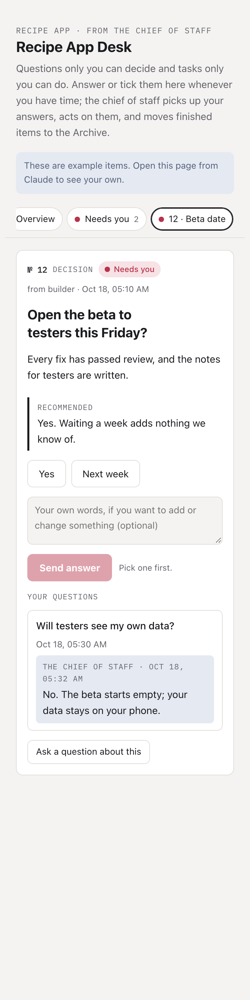
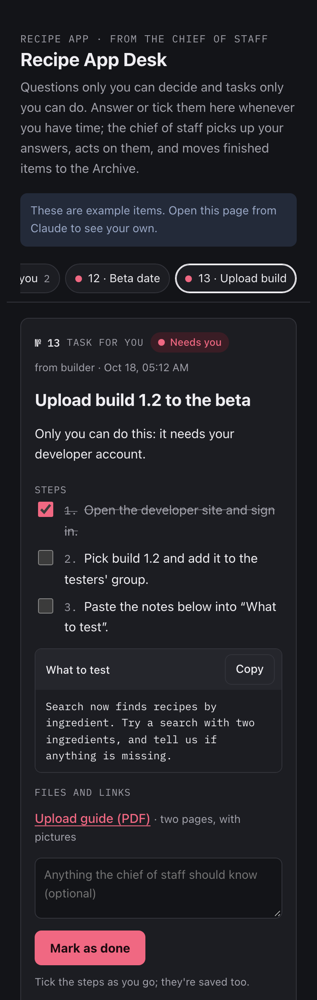

# owner-desk

A Claude Code skill that gives you one board for everything only you can
decide or do. The agent posts each item to it; you answer from your phone
whenever you have time.

> **What it needs:** Claude artifacts with a database (the `db` and
> `comments` capabilities), on claude.ai or in the Claude desktop app. It
> doesn't work in plain terminal Claude Code.


## The problem

When an agent needs you, it asks in chat. After a few hours, its questions
are buried between progress reports, a task only you can do is a paragraph
you have to scroll back to find, and you have to answer when the agent asks,
not when you have time.

## How the desk works

- **A Needs you tab, and one tab per item.** *Needs you* shows everything
  waiting for you, one after another; each item also has its own tab. A
  *decision* has a recommended answer and buttons.
  A *task* (an upload, a sign-in) has steps to tick, text to copy, and the
  guide attached.
- **You answer whenever you like.** Your answer is saved and also sent to
  the agent as a short comment, which wakes it straight away. The page tells
  you which applies: "…is told the moment you answer", or "Saved here; …
  reads it at its next check".
- **Answered items move apart.** They go to the *Decided* tab while the
  agent acts on them, so what still needs you stands out.
- **The agent archives what's done,** with one line on what happened. The
  Archive is the record of every decision.
- **Later** holds questions that can wait.
- **Ask about any item** ("what happens if I say no?"), and the answer
  shows on the same tab.
- **Swipe left or right** to move between tabs, handy on an iPad or a
  phone.

<p>
  
  
</p>

The items in these pictures are made up. Opened in a plain browser, the
page shows the same example items, so you can try it before using it.

## Install

```bash
git clone https://github.com/kl-autonomous/agent-team-skills.git
```

```bash
cp -R agent-team-skills/skills/owner-desk ~/.claude/skills/
```

## Use it

Say to the session you work with: "make me an owner desk for this
project". It publishes a private board, gives you the link, and from then
on posts its questions and your tasks there.

- When it restarts, give the new session the board's link in your first
  message, so it can start watching the board again.
- Only one session writes to a desk. If you use the
  [chief-of-staff](../chief-of-staff/) skill, that's the chief of staff:
  it posts everything it's waiting on you for and acts on your answers.

## Good to know

- The board is private to you unless you share it.
- Never put passwords or keys in an item. A task that needs one says where
  to type it, not what it is.
- Items live in the board's own database, so the page can be updated
  without losing them.

## License

MIT
